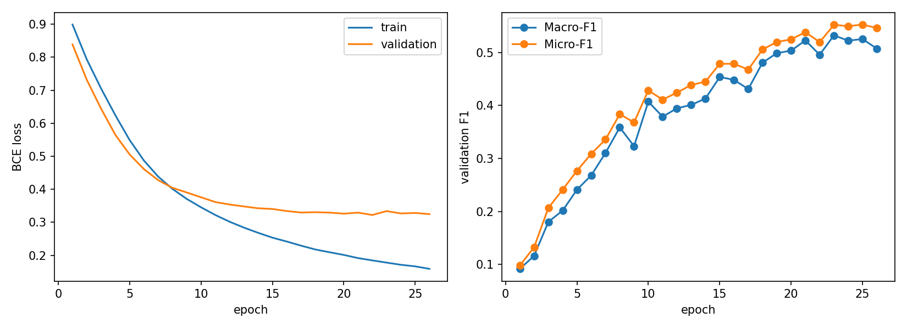
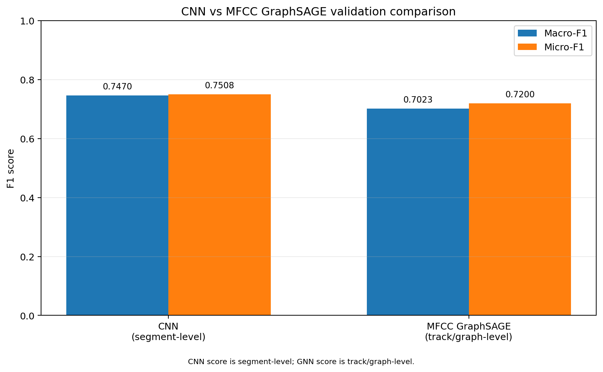
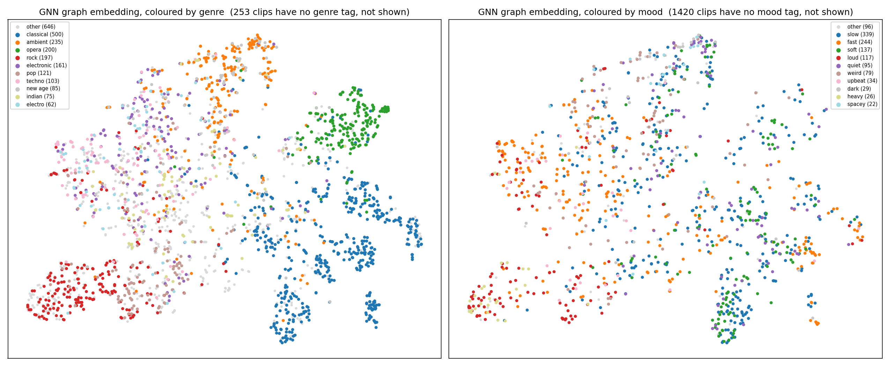
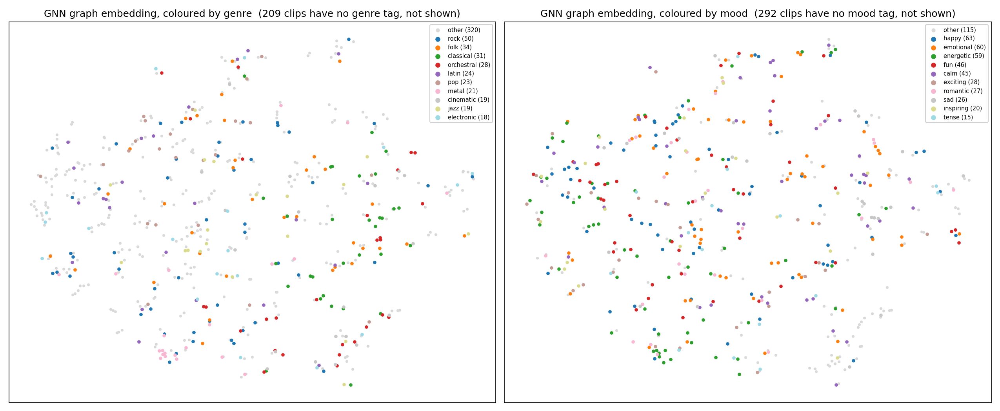

# GNN-BERT Music Context Understanding

Multi-label music context understanding by combining **graph neural networks** over audio segments with **BERT** text representations, evaluated over four tasks on MusicCaps, GTZAN and MagnaTagATune.

**Authors:** Humaira Anzum Neha, Sadman Sakib (CSE715, BRAC University)
**Report:** [report/1000060158_1000060159_Report.pdf](report/1000060158_1000060159_Report.pdf)

## Tasks

| Task | Dataset | Input → Output | Model |
|---|---|---|---|
| 1. BERT tag understanding | MusicCaps, 5,501 captions | caption → 65 tags (genre, mood, tempo) | Fine-tuned BERT |
| 2. GNN on music structure graphs | GTZAN, 999 tracks | segment graph → 1 of 10 genres | GraphSAGE |
| 3. GNN–BERT fusion | MagnaTagATune, 17,414 clips | segment graph + tag text → 53 genre/mood tags | GraphSAGE + BERT, cross-attention |
| 4. Contrastive audio–text alignment | MusicCaps audio, 5,299 clips | audio graph ↔ caption | Dual encoder, InfoNCE |

- **Task 1** fine-tunes BERT to predict curated music tags from free-text captions. It serves as the text-only upper reference.
- **Task 2** turns each track into a graph of 5-second segments and classifies its genre with a GNN, compared against a mel-spectrogram CNN.
- **Task 3** fuses the audio graph with BERT text through cross-attention for multi-label genre and mood prediction, with controlled ablations to separate the effect of each component.
- **Task 4** aligns audio graphs and captions in a shared embedding space, enabling caption ↔ audio retrieval and zero-shot tagging without tag supervision.

## Methodology

### 1. Audio segments as graphs
Each clip is resampled to 22,050 Hz and split into fixed segments (5 s; 2 s for MusicCaps). Each segment becomes a **node** whose features are time-pooled **MFCC** (26-d) and/or **chroma** (24-d) statistics, standardised with training-set statistics only.

**Edges** are a temporal chain $i \leftrightarrow i+1$ plus **similarity edges** between non-adjacent segments, with edge attributes `[is_temporal, similarity]`. Similarity is cosine on **track-centred** features:

$$\tilde{v}_i = v_i - \frac{1}{|V|}\sum_j v_j, \qquad s_{ij} = \frac{\tilde{v}_i^\top \tilde{v}_j}{\lVert \tilde{v}_i \rVert \, \lVert \tilde{v}_j \rVert}$$

Centring is required: pooled MFCC/chroma vectors share a large clip-level offset, so raw cosine is close to 1 for every pair. Two edge policies are compared: a threshold $\tau = 0.3$ and **top-k** ($k = 2$) per clip.

### 2. GraphSAGE encoder
Each layer aggregates the mean of a node's neighbours and combines it with the node itself; a mean-pooling readout gives the track embedding $g$:

$$h_i^{(l+1)} = \sigma\Big(W^{(l)} \big[\, h_i^{(l)} \,\Vert\, \operatorname{mean}_{j \in \mathcal{N}(i)} h_j^{(l)} \big]\Big), \qquad g = \frac{1}{|V|}\sum_{i \in V} h_i^{(L)}$$

Task 2 uses 3 layers with 64 hidden units on MFCC features.

### 3. BERT text encoder
- **Task 1:** `bert-base-uncased` fine-tuned end-to-end with a multi-label head on the `[CLS]` token (max length 256, AdamW, lr $2 \times 10^{-5}$, 10% warm-up).
- **Tasks 3–4:** lower BERT layers frozen; only the final transformer layers and task heads are trained.

### 4. Cross-attention fusion (Task 3)
The graph embedding queries the BERT token sequence, and the attended text vector is concatenated with the graph embedding:

$$Q = gW_Q,\quad K = H_{\text{text}}W_K,\quad V = H_{\text{text}}W_V,\qquad c = \operatorname{softmax}\!\Big(\frac{QK^\top}{\sqrt{d}}\Big)V,\qquad \hat{y} = \sigma\big(W_z[\,g \,\Vert\, c\,] + b_z\big)$$

### 5. Controlled ablations (Task 3)
Every variant shares classifier width, seed, loss, thresholding and evaluation, so only the branches and how they combine differ:
- **No-graph MLP:** the same node features, mean-pooled with all edges removed, through an MLP matched to the GNN in depth and width. This isolates the effect of **message passing**.
- **BERT only**, **linear probe on raw tags**, **early concatenation**, **cross-attention**, and **MLP + BERT**.

### 6. Contrastive audio–text alignment (Task 4)
Graph and text embeddings are projected and L2-normalised, $s_{ij} = g_i^\top t_j$, and trained with a **symmetric InfoNCE** loss with a learnable temperature:

$$\mathcal{L}_{\text{NCE}} = -\frac{1}{2N}\sum_i\left[\log\frac{e^{s_{ii}/\tau}}{\sum_j e^{s_{ij}/\tau}} + \log\frac{e^{s_{ii}/\tau}}{\sum_j e^{s_{ji}/\tau}}\right]$$

**Zero-shot tagging** follows CLIP: each tag name is embedded as text and scored against the audio embedding.

### 7. Training and evaluation
- **Loss:** `BCEWithLogitsLoss` with inverse-frequency `pos_weight` capped at 10 to control over-prediction on rare tags.
- **Optimiser:** AdamW, batch size 32, early stopping on validation AUC-PR.
- **Per-tag decision thresholds** tuned on the validation split and applied frozen to test.
- **Splits:** iterative multi-label stratification (80/10/10); no test data used for feature normalisation, training or model selection.
- **Metrics:** Macro-F1, Micro-F1, AUC-PR; Recall@K for retrieval.

## Results

### Task 1: BERT tag classification (MusicCaps, 504 test clips)

| Category | Tags | Macro-F1 | AUC-PR |
|---|---:|---:|---:|
| Genre | 40 | 0.6139 | 0.6631 |
| Mood | 22 | 0.5730 | 0.6112 |
| Tempo | 3 | 0.6464 | 0.6763 |
| **All** | **65** | **0.6016** | **0.6462** |



### Task 2: GTZAN genre classification

Test: accuracy **0.6333**, Macro-F1 **0.6024**, AUC-PR **0.7164** (majority baseline Macro-F1 0.0182). Feature ablation, validation Macro-F1:

| Node features | Macro-F1 |
|---|---:|
| Chroma only (24-d) | 0.4682 |
| **MFCC only (26-d)** | **0.7023** |
| Early concat (50-d) | 0.6641 |
| Two-branch late fusion | 0.6880 |
| CNN on mel-spectrogram* | 0.7470 |

\*The CNN is scored per segment, the GNN per track.



### Task 3: GNN–BERT fusion ablation (MagnaTagATune test)

| Variant | Params | Macro-F1 | AUC-PR | Genre AUC-PR | Mood AUC-PR |
|---|---:|---:|---:|---:|---:|
| Tags, linear probe | 19.5k | 0.2559 | 0.2209 | 0.2631 | 0.1317 |
| BERT only | 105k | 0.2495 | 0.2123 | 0.2582 | 0.1151 |
| GNN only | 172k | 0.2620 | 0.2350 | 0.2642 | 0.1731 |
| MLP only (no graph) | 105k | 0.2605 | 0.2464 | 0.2732 | 0.1894 |
| Fusion, concatenation | 208k | 0.3074 | 0.2945 | 0.3341 | 0.2107 |
| Fusion, cross-attention | 323k | 0.3186 | 0.3001 | 0.3465 | 0.2019 |
| **Fusion, MLP + BERT** | 165k | **0.3200** | **0.3013** | **0.3508** | 0.1964 |

Seed-to-seed variation is about ±0.004 AUC-PR.


*t-SNE of the GNN embedding coloured by genre (left) and mood (right): genres form compact regions, while mood structure largely follows the same timbral layout.*

### Task 4: Contrastive alignment (MusicCaps, 796-clip test gallery)

| Retrieval | R@1 | R@5 | R@10 |
|---|---:|---:|---:|
| Random embeddings | 0.0025 | 0.0075 | 0.0113 |
| Caption → audio | 0.0126 | 0.0766 | 0.1382 |
| Audio → caption | 0.0126 | 0.0678 | 0.1332 |

Zero-shot tagging reaches AUC-PR **0.0535** with no tag supervision, against **0.1502** for a supervised GNN on the same tags and splits and 0.0462 for the label prior.



### Key findings
- **Fusion helps:** combining audio and text raises AUC-PR from 0.2464 (best single modality) to 0.3013, a gain of +0.055, more than ten times the seed variation.
- **Graph edges add no measurable gain here:** the no-graph MLP matches the GNN alone (0.2464 vs 0.2350) and in fusion (0.3013 vs 0.3001). With five nodes and a mean-pooling readout, message passing mainly smooths features that are then averaged away.
- **Genre vs mood:** the GNN beats the MLP on genre and loses on mood in every run, matching how segment repetition relates to musical form rather than loudness or tempo.
- **Calibration matters more than thresholds:** capping `pos_weight` fixed systematic over-prediction; per-tag thresholds add about +0.012 Macro-F1 on MagnaTagATune but slightly hurt on MusicCaps.
- **Retrieval learns musical character:** contrastive training reaches 10–12× chance retrieval, and retrieved clips are plausible in style even when the exact clip is missed.

## Data

The `data/` directory (raw audio, processed features, graphs and splits) is not included because of its size. Download it from [Google Drive](https://drive.google.com/drive/folders/16CbINoBLB5tHmHbxkG8fRut24C0K9Ppj?usp=sharing) and place it at the repository root:

```text
gnn-bert-music-context/
├── data/
│   ├── raw/
│   ├── processed/{GTZAN, mtat, musiccaps}/
│   └── splits/
├── src/
├── results/
├── notebooks/
└── report/
```

## Repository layout

```text
src/
  bert_musiccaps_task1.py                            Task 1: BERT fine-tuning
  GTZAN_features.py  GTZAN_graphs.py  GTZAN_gnn.py   Task 2: graphs + GraphSAGE
  MTAT_features.py   MTAT_graphs.py   gnn.py         Task 3: graphs + GNN
  task3_mlp_nograph.py  task3_fusion.py              Task 3: controls and fusion
  musiccaps_features.py  run_musiccaps_supervised.py Task 4: features + supervised reference
  run_musiccaps_task4.py  task4_contrastive.py       Task 4: contrastive alignment
  train.py  evaluate.py                              entry point and metric aggregation
results/      saved metrics, curves, t-SNE plots, retrieval examples
notebooks/    eda.ipynb, demo_context.ipynb
report/       project report
```

## Running

```bash
pip install -r requirements.txt

python src/train.py --task 1                      # Task 1

python src/audio_features.py --dataset gtzan      # Task 2
python src/graph_builder.py --dataset gtzan
python src/train.py --task 2

python src/audio_features.py --dataset mtat       # Task 3
python src/graph_builder.py --dataset mtat
python src/train.py --task 3
python src/train.py --task 3 --variant mlp
python src/train.py --task 3 --variant fusion

python src/audio_features.py --dataset musiccaps  # Task 4
python src/train.py --task 4 --variant supervised
python src/train.py --task 4

python src/evaluate.py                            # aggregate saved metrics
```

See [REPRODUCE.md](REPRODUCE.md) for environment setup and reproduction details, and [DELIVERABLES_FINDINGS_GUIDELINES.md](DELIVERABLES_FINDINGS_GUIDELINES.md) for the task-by-task artifact mapping.
